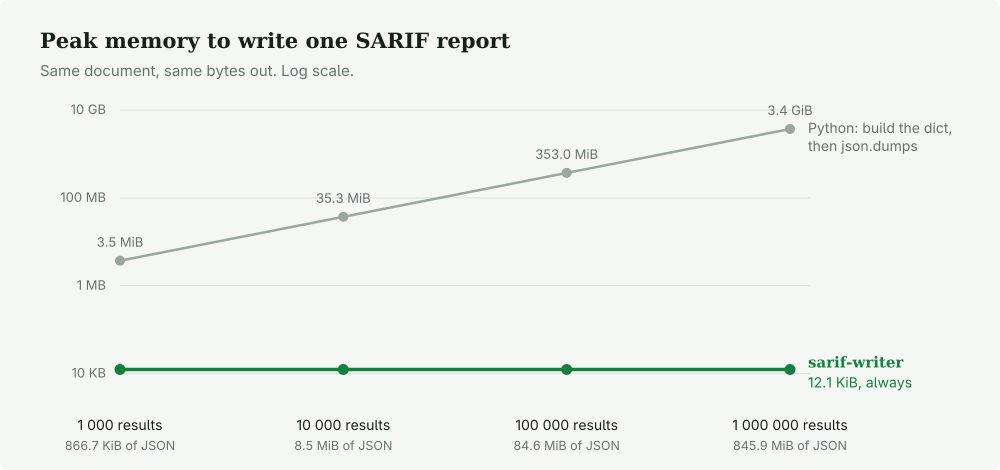

# sarif-writer

SARIF 2.1.0 reports from C, written as a stream. SARIF is the format GitHub code scanning,
Azure DevOps and the IDE viewers read; sarif-writer hands the document to a callback as it is
written, so a report with a million results needs the same memory as one with ten.

<picture>
  <source media="(prefers-color-scheme: dark)" srcset="docs/memory-dark.svg">
  
</picture>

Measured with [`bench/throughput.c`](bench/throughput.c), which counts every allocation, against
Python's `tracemalloc` while building the same results and calling
`json.dumps(indent=2, ensure_ascii=False)`. Both produce the same bytes: 887 510 for a thousand
results.

## What you get

- **Calls that follow the document.** `sarw_run_begin`, any number of `sarw_result`,
  `sarw_run_end`, `sarw_finish`. A call out of order returns `SARW_ERR_STATE` and writes
  nothing, so what reached your callback is always the start of a valid document.
- **Escaping you do not have to think about.** Every string is escaped; invalid UTF-8 becomes
  U+FFFD and sets `SARW_WARN_UTF8`.
- **Paths turned into URIs.** `sarw_location_t.path` is normalized (`\` to `/`, `.` and `..`
  resolved) and percent-encoded. With a `uriBaseId` it must stay relative; without one an
  absolute path becomes a `file://` URI. A ready URI goes in `uri` and is written as given.
- **Reproducible output.** Two-space indentation and a fixed key order: the same calls give the
  same bytes on every run and every platform.
- **C99, no dependencies,** one allocation of about 12 KiB, through your allocator if you pass one.

## Build and install

```sh
cmake -S . -B build -DBUILD_SHARED_LIBS=ON
cmake --build build
cmake --install build --prefix /usr/local
```

Then `find_package(sarif-writer REQUIRED)` and link `sarif-writer::sarif-writer`, or
`cc app.c $(pkg-config --cflags --libs sarif-writer)`.

To vendor it instead, `scripts/amalgamate.sh` writes `dist/sarif-writer/sarif-writer.h`. Define
`SARW_IMPLEMENTATION` before including it in one `.c` file, and `SARW_STATIC` as well to keep
every function private to that file.

## Use

```c
sarw_writer_t *w;

sarw_create(write_fn, ctx, NULL, NULL, NULL, &w);
sarw_run_begin(w, &tool);
sarw_result(w, &result);
sarw_run_end(w, NULL);
sarw_finish(w);
sarw_destroy(w);
```

A `NULL` allocator means `malloc` and `free`. `tool` carries the name and the rules; call
`sarw_result` as many times as there are findings; `sarw_run_end` optionally takes the artifacts
and an invocation with notifications. [`examples/sarif-hello.c`](examples/sarif-hello.c) is a
complete program with one rule and one result, and `include/sarif-writer/sarif-writer.h` is the
reference.

Every call returns `SARW_OK` or an error code that `sarw_strerror` describes. Strings are
NUL-terminated UTF-8 and are not kept after the call returns. Optional fields are `NULL`, or `0`
for numbers and counts; `rule_index` is `-1` to leave it out.

Give each result `partialFingerprints` (`sarw_result_t.fingerprints`): GitHub uses them to tell
that an alert in a new upload is the same one it already knows.

## Limits

A path in `sarw_location_t.path` is at most 4096 bytes. Nothing else is bounded, and memory does
not grow with the number or the size of the results.

## Tests

`ctest --preset dev` runs the unit tests under ASan and UBSan. `tests/oracle/` compares the
output byte for byte with the SARIF that
[fwtriage](https://github.com/augustoflorentino/fwtriage) renders and validates every document
against the 2.1.0 schema; `fuzz/fuzz_writer.c` throws random call sequences and hostile strings
at the writer.

## License

MIT, see [LICENSE](LICENSE). Semantic Versioning, changes in [CHANGELOG.md](CHANGELOG.md).
